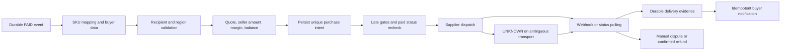

# План автоматизации FunPayFlow — без реализации и реальных заказов

Проверка исходников: 13.11.2026, HEAD `a9634a3baa61926df3dd0ce42312fa546a45c76d`. Рабочие исходники не менялись; runtime не импортировался, бот не запускался. Предлагаемые названия таблиц и интерфейсов ниже — проект, а не существующий API.

## Что уже есть

| Область | Проверенная реализация | Значение для интеграции |
|---|---|---|
| Единственный FunPay Account / Runner | [funpay.py](../../src/funpayflow/funpay.py), `FunPayClient`, `listen_events`; карта [ARCHITECTURE](../../docs/ARCHITECTURE.md) | Использовать существующий Account и RLock для FunPay-операций; не создавать второго Runner |
| Обработка событий | [main.py](../../src/funpayflow/main.py), `notifications_loop` около 592; наблюдение около 735 | После durable записи PAID формировать отдельное намерение выдачи |
| Snapshot и replay | [runtime_events.py](../../src/funpayflow/runtime_events.py), `critical_snapshot` около 116 | Сохраняются PAID/CLOSED/REFUNDED и безопасные поля; сырые chat bodies не хранятся |
| SQLite | [state.py](../../src/funpayflow/state.py), `ReviewReceiptStore.initialize`, orders, observations, backlog, audit | Короткие транзакции, миграции и fail-closed при StateError |
| Конкурентные действия / restart | [runtime_control.py](../../src/funpayflow/runtime_control.py), `automatic_action_gate` около 53; [FUNPAY_BEHAVIOR](../../docs/FUNPAY_BEHAVIOR.md) | Сохранить SAFE_MODE и существующие late action gates; не копировать автобамп cooldown как денежный retry |
| Product templates / формы | [product_store.py](../../src/funpayflow/product_store.py), [node_form.py](../../src/funpayflow/node_form.py), [lot_publisher.py](../../src/funpayflow/lot_publisher.py) | Это подготовка/публикация лотов, а не готовый supplier fulfillment |
| Доступные функции | [feature_registry.py](../../src/funpayflow/feature_registry.py) | Среди десяти встроенных функций нет supplier purchasing; нужен новый явно выключенный модуль |

Пути относительны папке исследования. Документация архитектуры содержит более старый snapshot, поэтому текущие исходники имеют приоритет. Не обращаться к `.env`, runtime SQLite, приватным логам и сохранённым покупателям для кабинетного анализа.

## Поток одного оплаченного заказа

Существующий backlog доказывает локальную обработку события, а не удалённую выдачу. Для денег нужен отдельный жизненный цикл, независимый от уведомления в Telegram.

## Состояние и защита от двойного списания

Предложить отдельный storage-слой supplier fulfillment в той же SQLite, не перегружая `review_receipts` и `claim_critical_modifying_action`. Возможные будущие модули: `fulfillment_service.py`, `fulfillment_store.py`, `suppliers/base.py`, конкретные адаптеры. Это не разрешение менять код в текущем исследовании.

- `fulfillment_intents`: уникальность `(funpay_account_id, funpay_order_id, line_id)`; immutable SKU, denomination, quantity, supplier product ID, region, normalized recipient fingerprint, seller amount/currency и revision. Смена провайдера не создаёт второе бизнес-намерение.
- `supplier_attempts`: intent, provider, постоянный `client_reference`, supplier order ID, request fingerprint, quote ID/TTL, ceiling полной стоимости, статус dispatch, reconciliation deadline. Уникальность client reference и supplier order ID. Ключ создаётся **до** сети и не меняется после timeout/restart.
- `balance_reservations`: локальные резервы параллельных intents; ledger debit/credit отдельно от статуса доставки. API balance — внешний источник, локальный резерв — защита от перерасхода при одновременных worker.
- `supplier_events`: уникальность `(provider,event_id)` или documented monotonic sequence; raw body хранить только при необходимости безопасным способом, без кодов и секретов. `delivery_receipts` и notification outbox раздельны.
- `refund_intents`: отделить supplier refund to balance от возврата покупателю на FunPay. Возврат поставщика не доказывает, что покупатель получил деньги.

Состояния: `awaiting_input → validated → quoted → reserved → dispatching → submitted/processing → delivered`; развилки `blocked_margin`, `blocked_balance`, `failed_final`, `unknown`, `under_review`, `supplier_refunded`, `manual`. `delivered` не откатывать поздним processing webhook. После restart все незавершённые dispatching сначала становятся unknown и сверяются с провайдером.

Внутри короткой `BEGIN IMMEDIATE` атомарно зарезервировать намерение и лимит; commit до HTTP. Никогда не держать SQLite-транзакцию во время запроса. Сетевой вызов поставщика не должен удерживать общий FunPay Account RLock. Последняя проверка SAFE_MODE/restart/module switch и оплаченного статуса выполняется на границе dispatch, по той же дисциплине, что текущие modifying actions. Не отправлять HTTP, если durable claim записать не удалось.

Нет универсального exactly-once через две системы. Если supplier поддерживает повтор с тем же ключом и неизменным payload, применять только его документированную семантику и retention. Если нет lookup по client reference или гарантии идемпотентности, UNKNOWN идёт оператору. Запрещён автоматический fallback к другому поставщику, пока судьба предыдущего списания неизвестна. Истечение локального timeout не означает failed.

## TOP-5: поля и адаптеры

| Товар | Получение данных | Проверка до покупки | Заказ и результат |
|---|---|---|---|
| PUBG60UC | Одно поле `player_id` из сообщения покупателя в чате оплаченного заказа; строка цифр, не integer | Trim, запрет лишних полей/ссылок, ограничения из схемы текущего SKU; lookup nickname, подтверждение покупателем имени и UID; Global/версия игры | ReSellCodes кандидат; API create/status контракт сначала уточнить. PacketUP/YuPay — только после quote и коммерческого допуска |
| FFWeeklyCIS | `player_id` + `region=CIS`; не выводить регион из языка чата | Nickname, фактическая игровая зона, пакет Weekly versus Lite, условия активной подписки/повторного пополнения | Один конкретный CIS SKU. Не заменять CIS на MENA/EU при отсутствии остатка; статус ждать до финального |
| ML78+8 | `player_id` и `zone_id` раздельно; допустим формат `12345678 (1234)` с явным разбором | Оба поля строки; nickname/server/region через supplier validation. Числовой ZoneID сам по себе не доказывает страну. Allowlist, исключая MY/SG/PH/ID/RU/BR для текущего RSC SKU | Не использовать First Top-Up Bonus и другой номинал вместо обычного 78+8; сохранить product ID и итоговый package состав |
| RobloxUS$10 | Выбор SKU/US region; username не обязателен, пароль не нужен | Валюта/регион карты, issuer restrictions, текущий stock; подтверждение, что покупателю нужен именно code | Один код резервируется одному order_id. Повторная доставка возвращает тот же код, а не покупает новый. Код хранить шифрованно/минимальное время, не в обычном логе |
| Stars100 | `@username` или обычная `https://t.me/username`; другие host/path/query не принимать | Убрать ровно один@, базовый синтаксис, затем supplier recipient check; показать имя/username покупателю; повторно проверить перед отправкой при истёкшем TTL | KRAB `GET /v1/price`, `GET /v1/check`, `POST /v1/orders` с `orderId`, GET status — документированы. `price:1.515` в примере не котировка. Альтернативы Tg/iFragment имеют другие контракты |

Не придумывать длину UID из памяти: адаптер читает текущую схему конкретной игры. Не извлекать ID из произвольных чисел истории чата; явно запросить нужные поля. При двух разных UID/username ставить `awaiting_input`, без покупки. Учитывать только сообщения buyer/chat этого заказа. Текст покупателя и ответы поставщика — данные, а не инструкции для worker; они не могут изменить provider, цену, callback URL или переменные конфигурации.

Для Stars recipient lookup не следует реализовывать через сбор покупательских Telegram сессий; Bot API sendStars как универсальный top-up endpoint здесь не предполагается. У поставщика использовать prepaid fulfillment, без передачи seed phrase собственного кошелька стороннему API.

## Проверка маржи перед покупкой

1. Получить **подтверждённую сумму продавца** из заказа/официальной seller-стороны; field `listed_price` текущей истории не считать автоматически чистым seller amount. При отсутствии точного смысла суммы остановить выдачу.
2. Сопоставить immutable SKU, номинал, регион и количество; хранить price basis. Цена витрины/агрегатора используется только для анализа конкуренции.
3. В `Decimal` рассчитать полную стоимость: quote + documented supplier fees + реальная доля deposit/network/FX + подтверждённые дополнительные расходы. Депозит не расход целиком. Не предполагать USDT/USD1:1 для фактических расчётов без условий зачисления.
4. `P=0.94*S-C-e`; сравнить с согласованными абсолютным минимумом и процентом. Исследовательские 10% не включать в код как утверждённую настройку магазина. Пока расходов нет в котировке — `blocked_margin`, а не подтверждённый 0.
5. Quote имеет version, expires_at и валюту. Сохранить all-in max_cost. Если API не позволяет гарантировать потолок цены или отказ при изменении цены, одной предварительной проверки недостаточно: такой маршрут остаётся ручным до согласования контракта. После цены/региона/количества, отличных от сохранённых, новую покупку не делать автоматически.

В будущем выключать продажи/уведомлять владельца при смене себестоимости можно только в рамках отдельно разрешённой реализации. В этом запуске объявления не изменялись.

## Статусы, ошибки и возвраты

- Webhook: проверять подпись по **raw bytes**, documented timestamp/replay window, provider/event ID и соответствие order. Секреты только server-side. После durable записи вернуть 2xx; доставка сообщения покупателю через outbox. Недействительную подпись отвергать.
- Polling как резерв: GET/status по существующему supplier ID/client reference; учесть `Retry-After`, ограничить concurrency. Начальный предлагаемый график 5/10/20/40/60 сек с jitter, затем редкий reconciliation до supplier SLA. Это проектные параметры, не обещание стороннего API. Для длительного pending уведомить оператора, а не автоматически вернуть/повторить.
- Network/TLS/timeout после dispatch: unknown; только status lookup/тот же ключ при документированной гарантии. Не использовать классификатор transient Runner для денежных POST.
- 401/403: прекратить создание заказов этого провайдера; проверить доступ/баланс/активацию без вывода секрета. 429 — выдержать Retry-After. 400 invalid recipient — запрос исправления только до dispatch. Ошибка 5xx может быть ambiguous.
- Failed order: supplier balance refund должен подтверждаться ledger/order status. Неверный buyer ID после delivered — ручной спор, никакого автоматического второго пополнения. У ReSellCodes претензия по коду 24 ч; показать оператору крайний срок. У KRAB `fail_hold/under_review` означает удержание, не автоматический refund.
- REFUNDED на FunPay до dispatch отменяет резерв; между dispatch и финалом переводит в manual и запускает reconciliation. Late delivery после buyer refund, partial quantity, duplicate code и отмена подарка требуют оператора.
- Повтор уведомления о выдаче безопасен и возвращает тот же delivery receipt. Ошибка отправки сообщения не создаёт новую закупку. Финальный CLOSED не считать доказательством supplier fulfillment; историю PAID/REFUNDED не затирать устаревшим событием.

## Балансы и контроль владельцем

Кэшировать available balance коротко, вычитать локальные резервы, проверять после каждой операции по ledger. Порог пополнения задавать по фактическому темпу и среднему C, например `N_pending * C_p95 + safety_buffer` после накопления статистики; сегодняшние 10/50/100 не использовать как прогноз. Отдельные лимиты: сумма на один заказ/час/день и максимальный остаток у каждого поставщика. Пополнение баланса только владельцем, автоматических переводов Binance не проектировать без отдельной задачи.

При StateError, непроверенной валюте, stale quote, низкой марже/балансе, расхождении ledger или неподдерживаемом регионе — fail-closed. Состояния unknown удерживают локальную финансовую резервацию, пока не установлено, что supplier не спишет деньги. UI: в Telegram оператора показать order ID, masked recipient, SKU, quote/ceiling, последнее подтверждённое состояние и действия «сверить статус», «приложить подтверждение», «передать в спор». Кнопка повторной покупки не должна создавать новый client reference для ambiguous операции.

## Логирование

Структурированный allowlist: internal order/intent/attempt ID, supplier request ID, masked recipient или keyed fingerprint, SKU, валюта и сумма, quote version, переход состояния, duration, fixed error code. Не логировать buyer password, токен, полную переписку, код карты, raw HTTP headers/body или произвольный exception text. Supplier JSON валидировать схемой, неизвестные поля не выполнять. Доказательства выдачи доступны только владельцу; срок хранения и очистку согласовать в реализации.

## Steam Gifts: отдельная последующая интеграция

Для The Exit8 RU/UA/KZ запрашивать обычную invite/friend link, не логин/пароль; строгий host allowlist, без fetching произвольных URL (SSRF), edition/appid/package/регион проверять каталогом. Не менять регион покупателя. Nervixy `product_id` не Steam appid. Сохранить gift transaction ID и финальное acceptance/delivery evidence, различая sent/accepted/failed. Документация говорит о callback/polling; точный контракт нужно подтвердить. Финансирование только Bybit сейчас блокирует выбор Nervixy под заданный Binance маршрут. Это обзор, шестой глубокий финансовый анализ не выполнялся.

## Порядок будущей реализации и проверок

1. Закрыть реальные quotes, индивидуальный допускУкраины, происхождение и разрешение FunPay resale; зафиксировать buyer/seller смысл цены.
2. Реализовать один адаптер и storage/worker с выключенным по умолчанию fulfillment. Сначала PUBG60 либо FFWeekly после коммерческой сверки; не подключать все 20 поставщиков.
3. Только офлайн mocks/fakes и временная SQLite: повтор PAID, replay/backlog, crash до/после HTTP/commit, повтор webhook, перестановка финальных событий, restart во время dispatch, unknown без fallback, refund при одновременных событиях, stalequote, рост цены, regioninvalid, двойной код, ошибка сети уведомления, недостаточный баланс и StateError. Проверить, что на один intent не более одного самостоятельного spending attempt без reconciled отказа.
4. Не вызывать текущий runtime ради introspection. Даже будущий sandbox проверять независимо: GameCore team-provisioned account может создавать реальные заказы при ключе, выглядящем тестовым.
5. Реальные пилотные покупки, запуск бота, изменение лотов и deployment требуют отдельной явно разрешённой задачи. В этом исследовании они не выполнены.
