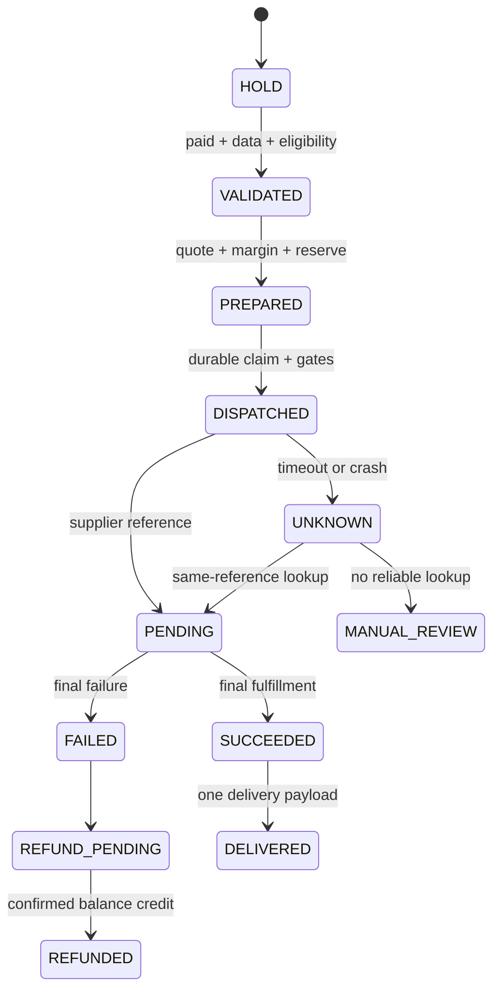

# Стратегия автоматической выдачи FunPayFlow

## Прочитанная архитектура и границы

Исходная main `a9634a3baa61926df3dd0ce42312fa546a45c76d`, прочитаны docs/ARCHITECTURE, FUNPAY_BEHAVIOR, PRODUCT_TEMPLATES и соответствующие исходники. Runtime не импортировался. Это проект будущей интеграции, не утверждение о наличии готового supplier fulfillment в боте.

- [funpay.py](../../../src/funpayflow/funpay.py): один FunPayClient/Account/Runner, общий RLock; get_order_snapshot берёт подробный заказ и account.id. NEW_ORDER сейчас формирует уведомление, не покупку у поставщика.
- [runtime_events.py](../../../src/funpayflow/runtime_events.py): critical_snapshot сохраняет допустимые order/status поля; message body не входит в critical backlog. На одном order ID возможны несколько событий и replay.
- [main.py](../../../src/funpayflow/main.py): _order_observation принимает PAID/CLOSED/REFUNDED, _order_history_fields хранит listed_price и количество лишь при явном наличии. Listed price и default quantity библиотеки не являются доказанной S/quantity.
- [state.py](../../../src/funpayflow/state.py): ReviewReceiptStore, WAL, critical backlog, durable modifying claims. Это основа локальной надёжности, но не end-to-end exactly-once supplier charge. Не переиспользовать review receipt как запись выдачи.
- [product_variants.py](../../../src/funpayflow/product_variants.py), product_store/drafts/routes: scoped template/route/variant и snapshots пригодны для определения SKU. Publisher имеет ограниченный offline slice, не готовый канал продажи/выдачи любого товара.
- [runtime_control.py](../../../src/funpayflow/runtime_control.py): SAFE_MODE, restart и late action gates сохраняются; новые закупки должны иметь собственный дополнительный флаг и нулевой доступ к реальным заказам по умолчанию.

Существующие рабочие файлы не менялись. CURRENT_STATE не обновляется: runtime/поведение не изменены, исследование изолировано здесь.

## TOP-5: входные данные и адаптер

| SKU | Что получать от покупателя | Проверка до оплаты | Предпочтительный адаптер-кандидат |
|---|---|---|---|
| PUBG660 | Player ID; build/global/KR/VN и country | Supplier lookup nickname/region; whitelist exact SKU | RSC/Packet/MooGold Global UID после approval |
| FFWEEKCIS | Player ID и account country | Nickname + список CIS стран + eligibility действующего membership | RSC CIS; Packet quote как альтернатива |
| MLWEEKRU | User ID и Zone ID отдельными строками | Lookup обоих; RU route и лимит подписки | RSC RU; не Global fallback |
| ARENA_ADV | Mobile Player ID, server/country | Отличить mobile от InfinitePC, exact Advanced/monthly pass | RSC/Packet после version mapping |
| STARS500 | Публичный @username | Resolve recipient; показать разрешённые display/ID для подтверждения; точные quantity limits | RSC/KRAB/Tg/PLATFORM iFragment по лучшему подтверждённому quote |

Синтаксис ID — строковый контракт конкретной игры; ведущие нули сохраняются. Username нормализовать без изменения внутреннего значения, запретить URL/инъекции; точный regex и resolving API сверить с поставщиком. Разрешённый lookup не доказывает владельца аккаунта, поэтому покупатель подтверждает найденного получателя. Не угадывать несколько ID из свободного текста. ML Zone не выводить из User ID. Не принимать buyer message как системную команду или источник SKU/скидки.

## Порядок обработки

1. Принять durable paid-order event, повторно получить snapshot через существующий Account lock. Проверить account owner, точный order ID, PAID, валюту, явное количество и immutable offer/node/variant→SKU mapping. CLOSED/REFUNDED не запускают новую покупку. Title fuzzy matching не определяет supplier product_id. Недостающая S или quantity блокирует автоматизацию.
2. Создать будущую запись fulfillment в той же схеме state через отдельную миграцию: unique(account, FunPay order, fulfillment line). Сохранить SKU/version, quantity, currency, подтверждённого recipient, supplier product reference и business hash. Существующее исполнение с другим hash → MANUAL_REVIEW, не новая покупка.
3. Выполнить lookup, eligibility/region check, balance read и **read-only quote**. API examples не quote. Сохранить quote_id/expiry, supplier fee, network/funding allocation, FX quote и e. Проверить `0.94*S-C-e >= configured_min_profit` и margin threshold. UNKNOWN в любом обязательном поле или истёкшая котировка → HOLD. Установленный оператором threshold — правило допуска, не историческая прибыль из отчёта.
4. Атомарно зарезервировать необходимый баланс/stock и записать PREPARED; короткая SQLite-транзакция заканчивается **до HTTP**. Persistent idempotency key зависит от owner/order/line, не от retry timestamp. Поздно проверить SAFE_MODE, pause/restart, supplier kill switch, unchanged recipient/SKU/quote. При изменении до dispatch — вернуть в HOLD.
5. Durable CLAIMED/dispatch marker перед созданием. POST supplier order с тем же external reference, если он поддержан документированно. Для Packet есть contract idempotency; MooGold partnerOrderId и duplicate420 требуют lookup, а не предположения «деньги не снялись». RSC/KRAB/Dessly детали confirm до реализации; не придумывать endpoint names.
6. Сохранить supplier order reference, normalized status и cost. Подписанный webhook с replay protection + polling fallback. Polling/read-only lookup может иметь ограниченный backoff/rate limit; modifying POST не повторяется только из-за timeout.
7. SUCCESS означает подтверждённое выполнение exact SKU/recipient. Разнести себестоимость и 0.06*S в ledger. Не считать FunPay CLOSED доказательством исполнения у поставщика или, наоборот, supplier SUCCESS подтверждением покупателя.
8. Final FAILED/REFUNDED поставщика — отдельные состояния. Refund FunPay и возврат в supplier balance учитываются раздельно. Не списывать выручку/затраты дважды; замена поставщика возможна только после подтверждения отсутствия первого исполнения и нового допуска.

Предлагаемые сущности: `fulfillments`, `supplier_attempts`, `cost_ledger`, `inventory_reservations`, `delivery_outbox`, `webhook_receipts`. Это спецификация, таблицы сейчас не добавлены. Вызовы внешнего HTTP не выполнять внутри SQLite transaction; Account RLock не удерживать на supplier HTTP.

## UNKNOWN, crash и двойное списание

Восстановление незавершённого CLAIMED/DISPATCHED начинается с UNKNOWN и сверки того же reference. Нельзя делать новый key, другой SKU или switch supplier при неизвестном исходе. Если API не предоставляет надёжный lookup/idempotency, интеграция допускается только к ручному разбору. Не обещать абсолютную exactly-once гарантию remote side effect.

## Выдача кодов и gifts — отдельный pipeline

Авторизованный stock code шифруется в закрытом хранилище вне Git, с batch/expiry и hash для дедупликации. Reserve привязывает один code к одному paid line. Durable outbox сохраняет **тот же** payload до отправки; после uncertain chat send проверить delivery receipt/историю допустимым способом, не выделять новый code. Внешний чат не даёт локальной exactly-once гарантии: повторная отправка того же кода возможна по явной политике, новая закупка — нет. Не логировать code/webhook raw body и не публиковать buyer ID/username в открытом отчёте.

Steam Gift: supplier product_id/region/package, Steam recipient reference, статус friend/invite и accept deadline по contract. Request friend link — не Steam password. Не смешивать gift delivery с instant key; WAITING_ACCEPT не failed и не повторный заказ.

## Баланс, журнал и ручной контроль

Доступный баланс = provider reported balance − локальные reservations; учитывать другие исполнения/платёжные pending. При low balance, stale quote, расходящемся ledger или неизвестных статусах ставить новые покупки на pause и уведомлять оператора в существующем авторизованном UI. Не пополнять автоматически из биржи. Оборотный резерв считать по реальному потоку после допуска; сценарий 100 orders/day не прогноз.

Журнал allowlist: internal order reference, SKU, normalized status, supplier order ID, quote revision, masked recipient, currencies/cost components и latency. Никаких Authorization, cookies, signature, buyer chat body, code или wallet session. Ошибки фиксированными категориями. Webhook signature, timestamp/nonce, duplicate receipt и price/recipient/order binding проверяются до смены статуса; unsigned success нельзя принимать на веру. Секреты будущей интеграции вводятся обычным secret manager вне исследования и не запрашиваются здесь.

MANUAL_REVIEW: wrong-recipient dispute, used code, region disagreement, charge without order reference, balance mismatch, duplicate webhook с разным outcome, issuer recall. Оператору нужны история безопасных статусов и supplier ticket, а не автоматический новый заказ.

## Безопасная проверка до реализации

Следующая техническая задача — offline adapter contract и fake supplier, без реального Account/runtime import. Deny-all network transport; временная SQLite; synthetic recipients и synthetic unusable codes. Проверки: duplicate paid event, crash до/после dispatch, timeout с выполненным debit, duplicate/out-of-order webhook, истёкшая цена, 0/unknown margin, low balance, wrong country, changed username, повторный code delivery, supplier refund vs FunPay refund. Fake проверяет ноль повторных charges, одинаковый external reference и один reserved payload.

GameCore account, созданный командой, может быть live даже с test-looking key; префикс не гарантия sandbox. До отдельного разрешения пользователя real CreateOrder, real top-up и бот не запускать. Отчёт не добавляет автоматический publish лотов и не меняет SAFE_MODE/restart/autobump/withdrawal поведение.
